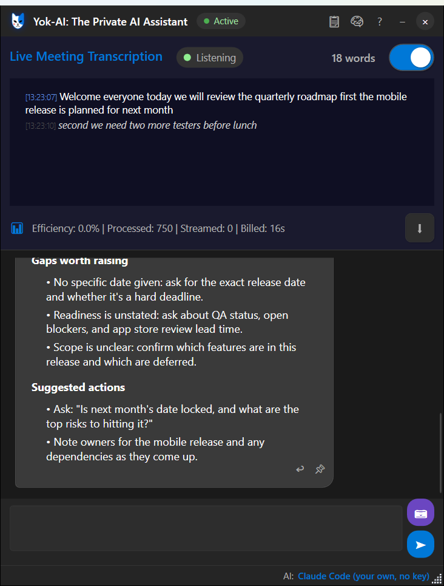
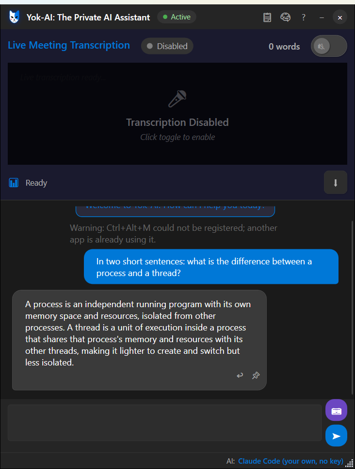
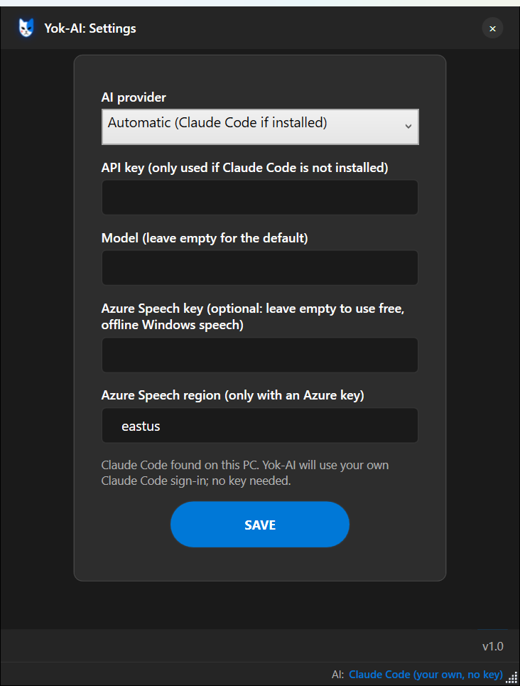
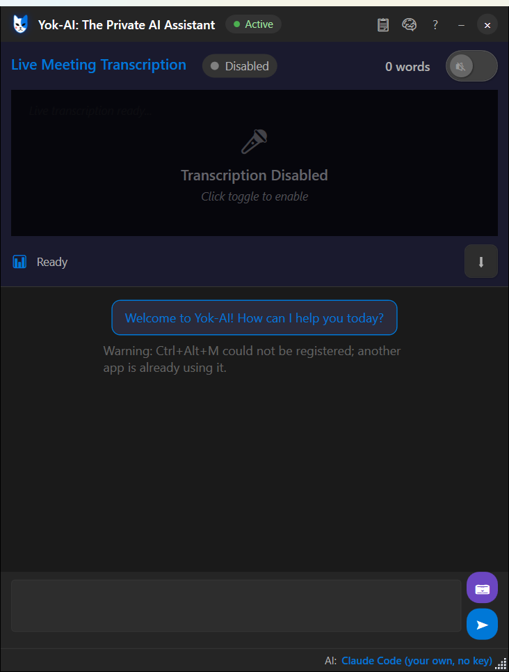
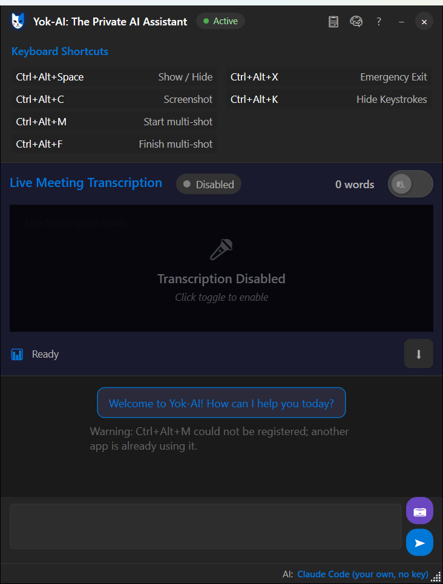
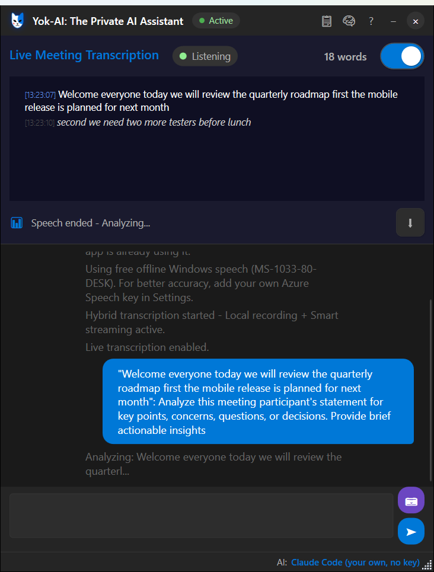
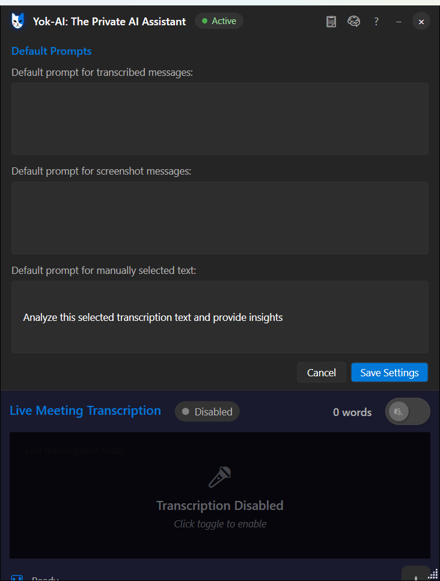

<div align="center">

# Yok-AI for Windows

**A free, open-source AI assistant that floats over your screen and stays out of screen shares.**

Ask questions, send screenshots, and get a live transcript of a call with AI notes as people talk.
No server, no account: you bring your own AI (your own Claude Code, an API key, or a local model).

[](LICENSE)


[](CONTRIBUTING.md)

</div>

> **About the screenshots:** Yok-AI hides its own window from screen capture, so a normal screenshot or recording shows only what is behind it. The pictures below were taken with the app started as `YokAI.exe --screenshot-mode`, which turns the hiding off for that run only.

<p align="center">
  
  
</p>

## Contents

- [Features](#features)
- [Choose your AI](#choose-your-ai)
- [Download and install](#download-and-install)
- [First run](#first-run)
- [Keyboard shortcuts](#keyboard-shortcuts)
- [Screenshots](#screenshots)
- [Privacy](#privacy)
- [Build from source](#build-from-source)
- [Contributing](#contributing)
- [Use it responsibly](#use-it-responsibly)
- [License](#license)

## Features

The full list, with details, is in [docs/FEATURES.md](docs/FEATURES.md).

**Stays private on your screen**
- Hidden from screen sharing and recording (Zoom, Teams, Meet, OBS, Snipping Tool and others see through it).
- Hidden from Alt+Tab and the taskbar; always on top and slightly see-through.
- Global shortcuts work from any app, so you never need to click on it.
- Keystroke protection: what you type goes only into Yok-AI, not the app underneath.
- Emergency exit closes it instantly and deletes your saved settings.

**AI chat**
- Works with your own Claude Code, Claude API, OpenAI, Groq, OpenRouter, Ollama or any OpenAI-compatible server.
- Send one screenshot or several at once, with thumbnails you can remove before sending.
- Reply to a specific answer (↩) or pin one (📌) to focus on it.
- Chat memory on or off (🧠): keep the conversation, or ask each question fresh.

**Live meeting transcription**
- Free and offline by default, using the speech recognizer built into Windows. Optional Azure Speech for higher accuracy with your own key.
- Hears the computer's audio (the other people in the call) through system loopback; no virtual cable needed.
- Live text as people speak, final lines with timestamps, word count and speaker-change detection.
- AI notes every few seconds: key points, open questions and suggested actions.
- Select any part of the transcript (or press Enter in it) to ask the AI about it.
- Records the meeting audio to a local WAV file, and exports the session.

**Meeting context**
- Set default instructions (📋) for transcript lines, screenshots and selected text, so every answer fits your meeting.

## Choose your AI

| Option | What you need | Cost |
|---|---|---|
| **Claude Code** (picked automatically if installed) | [Claude Code](https://claude.com/claude-code) installed and signed in on your PC | Your own Claude plan |
| Claude API | An Anthropic API key (`sk-ant-...`) | Pay as you go |
| OpenAI | An OpenAI API key | Pay as you go |
| Groq | A Groq API key | Free tier available |
| OpenRouter | An OpenRouter key | Many models, some free |
| Ollama | [Ollama](https://ollama.com) running on your PC | Free, offline |
| Custom | Any OpenAI-compatible server (LM Studio, vLLM, ...) | Your choice |

Transcription needs no key. For better accuracy you can add your own [Azure Speech](https://azure.microsoft.com/products/ai-services/ai-speech) key (Azure's free tier includes 5 audio hours a month).

## Download and install

1. Download `YokAI.exe` from the [Releases](../../releases) page. It is one file; nothing to install.
2. Run it. Windows SmartScreen may warn about an unsigned app: click **More info > Run anyway**.

**Requirements**
- Windows 10 version 2004 or later, or Windows 11 (needed for hiding from screen capture).
- .NET Framework 4.7.2 or later (already on almost every Windows 10/11 PC).
- For free transcription: an English Windows speech pack. If Yok-AI says none is installed, open **Settings > Time & language > Speech** and add one.

## First run



1. The Settings screen opens.
2. Leave **AI provider** on *Automatic* if you have Claude Code. Otherwise pick a provider and paste your key.
3. Optional: add an Azure Speech key and region. Leave them empty to use free Windows speech.
4. Click **Save**.

Click the AI name at the bottom of the window to open Settings again at any time.

**Using your own Claude Code**
1. Install Claude Code: https://claude.com/claude-code
2. Open a terminal and run `claude` once to sign in.
3. Start Yok-AI. It finds `claude` on your PC and sends questions through it. No key is stored in Yok-AI.

<br clear="right" />

## Keyboard shortcuts

| Keys | Action |
|---|---|
| `Ctrl+Alt+Space` | Show / hide the window |
| `Ctrl+Alt+C` | Take a screenshot and attach it |
| `Ctrl+Alt+M` | Start a multi-screenshot (take several) |
| `Ctrl+Alt+F` | Finish the multi-screenshot and send |
| `Ctrl+Alt+K` | Keystroke protection on / off (`Ctrl+Alt+H` does the same) |
| `Ctrl+Alt+X` | Emergency exit (closes and deletes saved settings) |

If another app already uses one of these, Yok-AI shows a one-line warning at start and the rest keep working.

## Screenshots

| Main window | Keyboard shortcuts (?) |
|---|---|
|  |  |
| **Live transcription** | **Meeting context (📋)** |
|  |  |

## Privacy

- **No Yok-AI server, account, analytics or telemetry.** The app talks only to the AI provider you chose.
- Your keys are saved only on your PC in `%LOCALAPPDATA%\YokAI\settings.dat`, encrypted with Windows DPAPI so only your Windows account can read them.
- Free Windows transcription runs fully on your PC. Audio goes to Azure only if you add your own Azure key.
- Meeting recordings (`Recordings\*.wav`), your default prompts and an error log stay in `%LOCALAPPDATA%\YokAI`.
- In Claude Code mode, screenshots are written to a temporary folder for the request and deleted right after.

## Build from source

1. Install [Visual Studio 2022 or later](https://visualstudio.microsoft.com/) with the **.NET desktop development** workload.
2. Open `StealthAssistWPF.sln`. NuGet packages restore on first build.
3. Build **Release**. The output is `StealthAssistWPF\bin\Release\YokAI.exe` (one file; libraries are bundled by Costura.Fody).

From a Developer PowerShell:

```powershell
msbuild StealthAssistWPF.sln -t:Restore -p:RestorePackagesConfig=true
msbuild StealthAssistWPF.sln -p:Configuration=Release
```

Run `YokAI.exe --screenshot-mode` to see the window in your own screenshots while testing.

**Code map**

| Path | What it does |
|---|---|
| `StealthAssistWPF/MainWindow.xaml(.cs)` | The UI, shortcuts, screenshots, transcription and AI notes |
| `StealthAssistWPF/Services/AiClient.cs` | All AI providers (Claude Code, Claude API, OpenAI-compatible) |
| `StealthAssistWPF/Services/AiSettings.cs` | Settings and encrypted local storage |
| `StealthAssistWPF/Services/WindowsSpeech.cs` | Free offline speech to text (Windows recognizer) |
| `StealthAssistWPF/Utilities/NativeMethods.cs` | Windows APIs: capture hiding, hotkeys |

## Contributing

Bug reports, ideas and pull requests are welcome. Read [CONTRIBUTING.md](CONTRIBUTING.md) for what you need and how to send a change, and [CODE_OF_CONDUCT.md](CODE_OF_CONDUCT.md). Report security problems privately as described in [SECURITY.md](SECURITY.md).

## Use it responsibly

Being hidden from screen sharing does not make it OK to break the rules of an exam, interview or meeting. Respect those rules and the people you talk to, and get consent where the law requires it before you record or transcribe a call. You are responsible for how you use this software.

## License

[MIT](LICENSE): free to use, change and share, including commercially, as long as the copyright notice stays. The software comes with no warranty.
